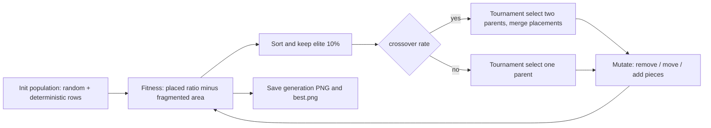

<p align="center">
  
</p>

<p align="center">
  
</p>

<p align="center">
  
  
  
  
  
  
</p>

<p align="center">
  
  <br/><sub>Real frames rendered by the script: the best layout of each generation, from generation 1 (60 pieces) to generation 57 (62 pieces) on a 244 x 122 plate with 42 x 9.5 pieces.</sub>
</p>

## 📑 Table of contents

- [Overview](#-overview)
- [Features](#-features)
- [Demo and results](#-demo-and-results)
- [Architecture](#-architecture)
- [Tech stack](#-tech-stack)
- [Requirements](#-requirements)
- [Installation and configuration](#-installation-and-configuration)
- [Usage](#-usage)
- [Project structure](#-project-structure)
- [Testing](#-testing)
- [Troubleshooting and FAQ](#-troubleshooting-and-faq)
- [Roadmap](#-roadmap)
- [Contributing](#-contributing)
- [License](#-license)
- [Author](#-author)

## 🌍 Overview

**Problem:** cutting identical rectangles out of a fixed sheet (a 2D cutting-stock / nesting problem) is NP-hard. Naive row packing wastes material at the edges, and exhaustive search does not scale.

**Solution:** a genetic algorithm evolves whole layouts. Each individual is a list of placements (position plus optional 90 degree rotation) on an occupancy-grid plate. The fitness rewards the number of pieces placed and penalises fragmented leftover area that is too small to hold any piece, which pushes the search toward layouts with usable offcuts. Every generation's best layout is rendered so you can watch the optimisation.

## ✨ Features

- **Occupancy-grid plate model** (NumPy) with configurable resolution; overlap and bounds checks per placement.
- **Population initialisation** mixing random placements (with random rotation) and 20 deterministic "side-by-side" row-packing individuals as strong seeds.
- **Fitness function**: `w1 * (pieces placed / pieces requested) - w2 * (unusable area / total area)`, where unusable area is found by labelling connected empty regions (`scipy.ndimage.label`) and counting those too small to hold any piece in any orientation.
- **Genetic operators**: tournament selection, overlap-free crossover that merges placements from both parents, and mutation (remove, relocate, add pieces), plus 10% elitism.
- **Visual output**: each generation is saved as `plate_layout_gen_XXXX.png` and the current best as `best.png` (Matplotlib, headless `Agg` backend).

## 🎬 Demo and results

| Generation 1 | Generation 57 |
| --- | --- |
|  |  |

### Evaluation

| Run | Plate | Piece | Pieces placed | Context |
| --- | --- | --- | --- | --- |
| Captured demo, generation 1 (after seeding) | 122 x 244 | 42 x 9.5 | 60 | Best of the initial population (random + row-packing seeds) |
| Captured demo, generation 57 | 122 x 244 | 42 x 9.5 | 62 | Run interrupted here; configured for 500 generations, so this is not a converged result |
| Quick-start run (3 generations, 30 individuals, resolution 2) | 40 x 60 | 10 x 5 | 48 | Equals the area bound `40*60 / (10*5) = 48`, i.e. a perfect tiling |

For scale, the area-only upper bound for the demo is `122*244 / (42*9.5) = 74.6`, so at most 74 pieces could fit even with zero waste (this bound ignores geometry and is not attainable in general). The demo shows the algorithm improving on its seeds (60 to 62) within 57 generations; a full 500 generation run was not completed.

### Known limitations and next steps

- Long runs are slow because the fitness step re-labels the whole grid for every individual; a rectangle-based free-space representation would be far faster.
- Only one piece shape is exercised in the demo (see roadmap).
- No convergence plot or seeded benchmark is included yet, so run-to-run variance is not quantified.

## 🏗 Architecture



## 🧰 Tech stack

| Layer | Technology |
| --- | --- |
| Language | Python 3.12 |
| Numerics | NumPy (occupancy grid), SciPy (`ndimage.label`), pandas (grid printing) |
| Visualisation | Matplotlib (`Agg` backend, PNG output) |

## 📋 Requirements

| Item | Requirement |
| --- | --- |
| OS | Windows, macOS or Linux |
| Python | 3.12 (developed and verified with 3.12.3); `pip` |
| Libraries | `numpy`, `pandas`, `scipy`, `matplotlib` (see `requirements.txt`, versions unpinned) |
| Hardware | CPU only, no GPU. The default run (500 generations, 200 individuals, resolution 10) is CPU heavy |
| Memory | `try_fit` refuses grids above about 100 MB (`plate_width * plate_height * resolution^2 * 4 bytes`) |
| Accounts / API keys | None |
| Disk | Each generation writes a PNG to the current directory, so long runs create many files |

## 🔧 Installation and configuration

```bash
git clone https://github.com/ORD1STAR/genetic-plate-packing-optimizer.git
cd genetic-plate-packing-optimizer
python -m venv .venv
source .venv/bin/activate        # Windows: .venv\Scripts\activate
pip install -r requirements.txt
```

**Environment variables:** none. All configuration is passed as arguments to `try_fit`:

| Parameter | Default | Description |
| --- | --- | --- |
| `plate_shape` | required | Plate size as `(width, height)` |
| `objects_to_place` | required | List of piece shapes, e.g. `[(42, 9.5)]` |
| `resolution` | `1` | Grid cells per unit length (higher is more precise and much slower) |
| `generations` | `50` | Number of generations |
| `individual_per_generation` | `100` | Population size |
| `w1`, `w2` | `1`, `2` | Weights of the placed-pieces term and the unusable-area penalty |
| `mutation_rate` | `0.1` | Mutation probability |
| `crossover_rate` | `0.7` | Crossover probability |

## 🎮 Usage

Run the default configuration (42 x 9.5 pieces on a 122 x 244 plate, resolution 10, 500 generations of 200 individuals; slow):

```bash
python best_positions.py
```

Quick try (about 7 seconds in a verification run):

```python
from best_positions import try_fit
try_fit((40, 60), [(10, 5)], resolution=2, generations=3,
        individual_per_generation=30, mutation_rate=0.4)
```

Images (`plate_layout_gen_XXXX.png`, `best.png`) are written to the current working directory.

## 🗂 Project structure

<details>
<summary>Show tree</summary>

```
best_positions.py   plate/object classes, GA operators and the try_fit() entry point
requirements.txt
docs/               frames and GIF produced by a real run of the script
LICENSE
```

</details>

## 🧪 Testing

There is no automated test suite. The quick-start call above doubles as a smoke test: it should finish in seconds and place 48 pieces on the 40 x 60 plate.

## 🛠 Troubleshooting and FAQ

<details>
<summary>ValueError: resolution ... would create an array that is too large</summary>

The grid has `plate_width * resolution * plate_height * resolution` cells. Lower `resolution` or the plate size.
</details>

<details>
<summary>"Blocked! Exceeded 40 random tries" appears during initialisation</summary>

This is a normal message from the deterministic row-packing seeds when no further piece fits; it is not an error.
</details>

<details>
<summary>No window opens</summary>

The script uses Matplotlib's headless `Agg` backend and only writes PNG files. Open the generated images instead.
</details>

<details>
<summary>The run takes too long</summary>

Reduce `generations`, `individual_per_generation` or `resolution`. Fitness evaluation labels the whole grid per individual, which dominates run time.
</details>

## 🗺 Roadmap

- [ ] Support several piece shapes in the random initialiser (the code accepts a list but uses the first shape)
- [ ] Faster free-space representation instead of re-labelling the grid
- [ ] Convergence plot and multi-seed benchmark
- [ ] Command line interface for parameters
- [ ] Guillotine-cut constraints

## 🤝 Contributing

Issues and pull requests are welcome. Please include the plate size, piece list and parameters needed to reproduce a result.

## 📄 License

Released under the [MIT License](LICENSE).

## 👤 Author

<table>
  <tr>
    <td><b>Hannoun Amine Amar</b><br/>AI Engineer / Fullstack Developer, Algeria</td>
    <td>
      <a href="https://www.linkedin.com/in/hannoun-amine/"></a>
      <a href="https://github.com/ORD1STAR"></a>
      <a href="mailto:hannoun.amine25@gmail.com"></a>
    </td>
  </tr>
</table>

<p align="center">
  
</p>
