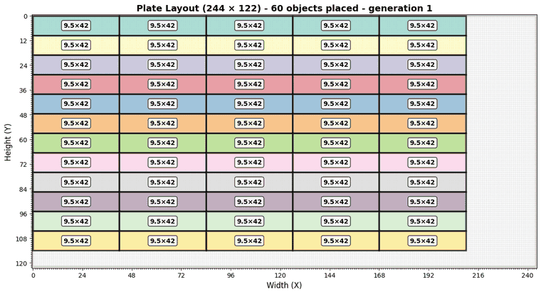
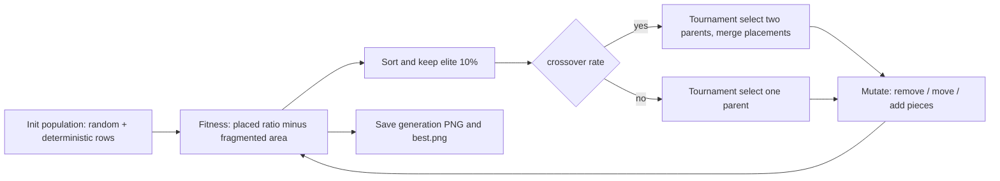
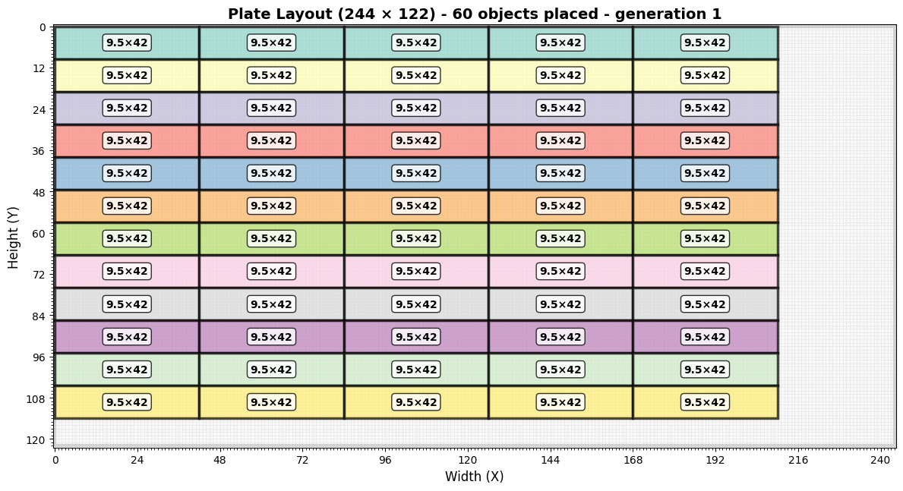
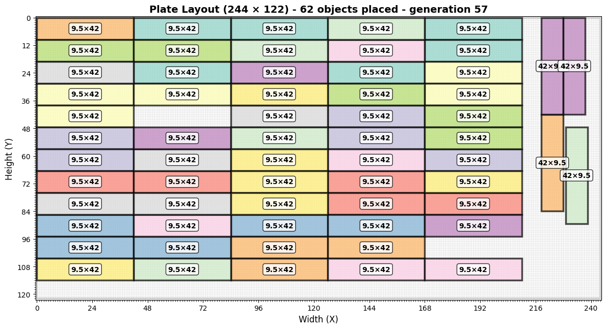

# Genetic Plate Packing Optimizer

A genetic algorithm that packs as many rectangular pieces as possible onto a fixed plate (a 2D cutting-stock / nesting problem), with rotation support and live visualisation of every generation.




*Real frames rendered by the script: the best layout of each generation, from the first generation (60 pieces) to generation 57 (62 pieces) on a 244 x 122 plate with 42 x 9.5 pieces.*

## Features

- **Occupancy-grid plate model** (NumPy) with configurable resolution; overlap and bounds checks per placement.
- **Population initialisation** mixing random placements (with random rotation) and 20 deterministic "side-by-side" row-packing individuals as strong seeds.
- **Fitness function**: `w1 * (pieces placed / pieces requested) - w2 * (unusable area / total area)`, where unusable area is found by labelling connected empty regions (`scipy.ndimage.label`) and counting those too small to hold any piece in any orientation.
- **Genetic operators**: tournament selection, overlap-free crossover that merges placements from both parents, and mutation (remove, relocate, add pieces), plus 10% elitism.
- **Visual output**: each generation is saved as `plate_layout_gen_XXXX.png` and the current best as `best.png` (Matplotlib, headless `Agg` backend).

## Tech stack

Python, NumPy, SciPy, pandas, Matplotlib.

## How it works



## Getting started

```bash
pip install -r requirements.txt
python best_positions.py
```

The default run (bottom of `best_positions.py`) packs `42 x 9.5` pieces on a `122 x 244` plate at resolution 10 with 500 generations of 200 individuals; this is CPU heavy. For a quick try, call `try_fit` yourself:

```python
from best_positions import try_fit
try_fit((40, 60), [(10, 5)], resolution=2, generations=3,
        individual_per_generation=30, mutation_rate=0.4)
```

Images are written to the current working directory.

## Results

| Generation 1 | Generation 57 |
| --- | --- |
|  |  |

The captured run was interrupted at generation 57 (the script was configured for 500), so the figures above are the state at that point, not a converged optimum. Final-frame render of the best layout: [docs/best.png](docs/best.png).

## Project structure

```
best_positions.py   plate/object classes, GA operators and the try_fit() entry point
requirements.txt
docs/               frames and GIF produced by a real run of the script
```

## Notes and roadmap

- Pieces are all the same size in the demo; the code accepts several shapes in `objects_to_place` but the random initialiser currently uses the first one.
- Fitness evaluation re-labels the whole grid for every individual, which dominates run time; a rectangle-based free-space representation would be far faster.
- Possible next steps: guillotine-cut constraints, parameter CLI, convergence plots.

## Author

**Hannoun Amine Amar**, Algeria
[LinkedIn](https://www.linkedin.com/in/hannoun-amine/) | hannoun.amine25@gmail.com

Licensed under the MIT License.
